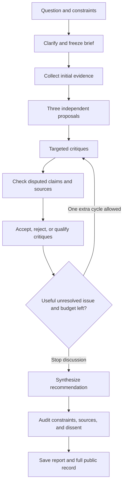
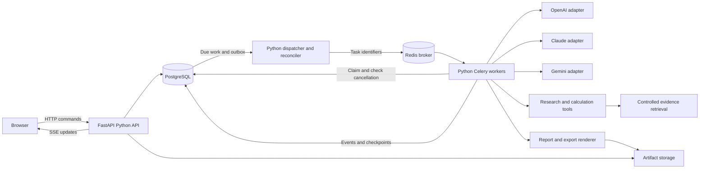

# Round Robin AI Meeting Room Product and Implementation Plan

Version 7 • November 15, 2026 • Product decisions with build-ready implementation contracts

Round Robin will help people make important decisions with evidence, independent AI review, and a clear next step. Users receive a recommendation they can inspect, challenge, and revisit as their circumstances change. The meeting between advisers is the mechanism; decision usefulness is the product standard.

The first release is a personal web application for comparing two to four small-business project approaches or supplier offers against a budget, deadline, and local constraints. It includes three providers, inspectable evidence, the independently evaluated Standard protocol, persistent history, and downloadable reports. Deeper debate is built and enabled only if evaluation justifies it. Validate the customer workflow and provider economics before broad construction, then build one complete decision journey before expanding features.

**Current status (November 16):** construction has continued into the durable local product, provider/worker/budget infrastructure, private evidence and exports, hosted controls, recovery and gated visual/native extensions. The user explicitly authorized building through later phases before resolving external blockers; this supersedes the construction-order dependency below. Research, funding, usefulness, accessibility and hosted/visual release acceptance still require real evidence. See the [current implementation record](evidence/implementation-phases.md) and the historical [Phase 0 preparation record](evidence/phase0-preparation.md). Round Robin has no relationship to the round robin scheduling algorithm.

Read [failure handling and recovery](FAILURE_HANDLING.md) for scenario-by-scenario code ownership, retry and timeout policy, state decisions, and fault-test assertions. Read [implementation phases and verification](IMPLEMENTATION_PHASES.md) for deliverables, dependencies, tests, completion evidence, and release gates. This document defines product scope and architecture; those companion documents define detailed failure policy and phase execution respectively.

The [visual design and image review plan](VISUAL_DESIGN_WORKFLOW.md) extends this system to actual-image critique, bounded generation/editing, version comparison and native design checks in phases 7–9. The core text release remains phases 0–6; its implementation status and limits are not silently changed by that extension.

The [product audit](PRODUCT_AUDIT.md) records the findings and decisions behind Versions 6–7. The [implementation blueprint](IMPLEMENTATION_BLUEPRINT.md) specifies the schemas, API transactions, privacy boundaries, readiness reducer, budgets, evaluation records and operator controls needed to build them. The [delivery backlog](DELIVERY_BACKLOG.md) orders the work. This plan owns scope and target definitions; the blueprint owns detailed implementation contracts, the phase plan owns delivery gates, and failure handling owns invariants/IDs. Unmeasured targets below are hypotheses, not passed checks.

## Product judgment

This is a worthwhile project for questions involving tradeoffs, competing proposals, incomplete information, or a need for independent review. Building design concepts, software architecture, business planning, research synthesis, and purchasing comparisons are good examples. A simple factual lookup often needs a shorter workflow.

The difficult part is not making three models exchange messages. It is detecting unsupported claims, preventing the models from copying one another's mistakes, knowing when to stop, and making the conclusion traceable. Models should be able to say that a question remains unresolved.

Research provides reasons to test this approach, not a universal guarantee. Du and colleagues reported improvements on evaluated reasoning and factuality tasks. Later evaluations found that debate does not consistently beat simpler approaches and that the setup and choice of models matter. Our design inference is to preserve independent first answers, use different providers, and test against strong baselines before claiming superior accuracy. [Original debate study](https://arxiv.org/abs/2305.14325), [comparative evaluation](https://arxiv.org/abs/2311.17371), [evaluation and model diversity study](https://arxiv.org/abs/2502.08788).

**Product promise:** Make important decisions with evidence, independent review, and a clear next step.

“The correct answer to any question” is not a defensible promise. Some questions depend on preferences, missing measurements, current local information, or professional judgment. The product should distinguish these cases rather than hide them behind a confident vote.

## Launch audience and scope

Design the first experience for an individual owner or operator comparing two to four ways to deliver one small-business project, including structured supplier-offer summaries. A useful question is: “Which approach best fits my budget, deadline, site, and maintenance needs?” Begin with one **Project option comparison** template. Keep general question entry available, but distinguish it from the evaluated launch use case. The farm-building concept remains an expansion example rather than a construction-design launch promise.

The template captures the intended outcome, candidate options when known, hard requirements, ranked preferences, budget and currency, deadline, location, supplied evidence, and the next decision the user needs to make. Distinguish user-supplied facts from assumptions. One successful intake can propose missing options and at most three clarification questions in one batch; user confirmation deterministically freezes two to four candidate options. A status-quo baseline is additional to those candidates. Contradictory hard requirements produce a clarification or an explicit explanation that no feasible option has been established.

Always consider keeping the current approach, deferring, or obtaining a missing quote as the status-quo baseline; record why it is inapplicable when excluded. Show reversibility and material consequences of waiting. A purchase should not win merely because every listed purchase is poor.

The MVP includes a useful Overview, inspectable evidence, a complete public discussion, a saved report, a follow-up change summary, and lightweight records of the user's eventual choice and outcome. Team administration, voice, broad integrations, automatic project memory, and rich document extraction follow demonstrated demand. Construction examples produce concepts and briefs for local review; they do not replace site-specific professional design.

Use one Standard preset selected through the early evaluation. All three providers remain configured participants. The provisional direction is independent proposals, synthesis and independent audit. Build and expose bounded debate only when its own comparative evaluation passes; an unproven path remains disabled, rather than a mandatory MVP feature. Store the selected protocol with each run and explain its work before starting. Single-model workflows are evaluation baselines, not silently substituted multi-provider meetings.

Local personal use relies on operator-configured server-side keys. An invited hosted pilot uses operator-funded providers with explicit owner and deployment quotas; participants do not need three provider accounts. Hosted user-supplied keys, subscriptions, checkout, public sharing and billing are separate future product decisions. A sample report requires neither keys nor paid calls. Do not begin visual development until the demand gate in the visual plan passes.

## Image output and design use cases

Visual mode adds a shared artifact to the discussion. Generate or upload V1, provide the actual image to independent vision-capable advisers, resolve specific version-bound findings, and create V2/V3 only when a targeted edit is worthwhile and funded. Review each new result against the original brief and locked requirements, retain regressions and disagreement, and let the user choose any saved candidate or decline all.

Separate image generation/edit capabilities from image understanding. Two distinct capable critics outside the actual generator provider are required for a complete generated-image review; self-critique is supplementary. Bind reviews to server-recorded artifact/view hashes and actual image-input receipts. Prompt-only commentary cannot count as visual inspection. Unknown creator provenance on an upload is disclosed.

Use raster generation for artwork, native components plus screenshots and interaction tests for interfaces, and editable source plus structure checks for diagrams. Building/farm images remain concepts with site and professional-validation dependencies. Appearance review cannot certify working software or engineering correctness. Native rendering uses a separately gated sandbox in Phase 9, not the text MVP's tool permissions.

The selected visual preset permits V1 plus at most two edits, four dispatched image-submission attempts total, and at most 24 actual upstream inference attempts across all modalities regardless of billing, within one monetary limit and a declared 1,800-second active ceiling. Protect review headroom before generating another candidate. The text preset retains its 600-second ceiling. Image jobs use capability-specific recovery and separate long-call workers where needed; the visual plan defines exact limits and failure tests.

## Decisions for the first release

| Area | Decision | Reason |
| --- | --- | --- |
| Audience | Individual owners comparing small-business project options | Define a repeatable task with observable decisions and outcomes |
| First template | Project option comparison with hard requirements and ranked preferences | Make intake and the final comparison useful immediately |
| Participants | OpenAI, Anthropic Claude, and Google Gemini | Provide the requested provider diversity |
| Roles | Configurable perspectives independent of provider | Avoid assuming a brand is inherently the best designer or critic |
| Protocol | Ship only the evaluated Standard path; gate deeper debate separately | Avoid building or funding stages without measured user benefit |
| Default view | Recommendation, reasons, tradeoff, uncertainty, sensitivity, and next action | Let users understand the decision without reading a transcript |
| Control | Application code owns scheduling and stopping | Keep cost, permissions, and termination predictable |
| Implementation | Next.js and TypeScript frontend; Python API and workers | Honor the preferred backend language and support Python tools |
| Contracts | Pydantic models with generated OpenAPI and TypeScript contracts | Keep frontend and backend interfaces consistent across languages |
| Persistence | PostgreSQL for application records and durable work intentions | Keep meeting state and recovery independent of the broker |
| Jobs | Celery workers with a Redis broker | Run bounded Python tasks outside the API process |
| Live interface | Server-sent events for updates; HTTP for commands | Fit the mostly server-to-browser communication pattern |
| Evidence | Shared retrieval, passage-level support, counterevidence, and freshness checks | Make critical dependencies inspectable and suitable for reuse |
| Reports | Saved web report plus Markdown and PDF | Support both reading and sharing |
| Quality standard | Evidence and constraint checks, with visible dissent | Model agreement alone cannot establish truth |
| Quantitative comparison | Bounded deterministic calculation, comparable horizons and missing-component labels | A budget-centered recommendation must not rely on model arithmetic |
| Funding and access | Local operator keys; operator-funded invited hosted pilot | Keep three-account setup out of end-user onboarding |
| Validation sequence | Target-user discovery and prototype, then paired provider comparison | Establish workflow demand and acceptable cost before broad implementation |

Use Python for the backend, as requested. FastAPI handles the HTTP API and live event delivery; separate Python workers handle provider calls, research, and report generation. The frontend remains Next.js and TypeScript. Generate browser-facing contracts from the Python schemas to keep the two languages aligned.

## User experience

### First use and provider setup

Offer a clearly labeled saved sample meeting that can be inspected without keys or paid calls. It demonstrates the Overview, a disputed claim, an exact supporting passage, and a follow-up change. Sample and simulated meetings remain visibly labeled throughout the interface and exports.

Guide personal users through server-side provider configuration with sanitized connection status and actionable errors. State when a connection test will make a paid request and obtain the same explicit start action used for other paid work. Never place provider secrets in browser storage. Before starting a real meeting, show which providers receive the question and attachments, the selected review path, spending limit, and an estimate of work based on available measurements.

Bind that display to a deterministic saved preflight, valid for ten minutes before Start, containing the draft revision, selected hashes, shared three-provider recipient set, approved public terms, protocol/model/prompt/pricing versions and limits. Start consumes it for one unique run and supplies the expected revision; stale settings or another command reusing that preflight dispatch no new work. Show a 30-minute initial-admission expiry so accepted work cannot begin days later without renewed consent. After a valid clarification/retry, a command-bound resumption ticket also expires after 30 minutes without renewing active time or counters. Precise transaction/error contracts are in the blueprint.

Separate operator setup from the user's first decision. In the hosted pilot, show service availability and the user's remaining allowance rather than asking for API keys. Before paid access is enabled, the operator must configure aggregate quotas and retention. No live connection test runs merely because a key exists.

### Start a meeting

The home screen shows recent meetings, their status, and a prominent question field with the Project option comparison template. The form captures the question and optional background, then turns constraints and preferences into a short brief the user can correct before review begins. Keep advanced model controls out of this primary path.

Save an editable server-side draft before paid Start. Users can directly change options, quote components, hard requirements, preference order, evidence selection and location. Draft edits, autosave and deterministic preflight perform no inference. Show autosave failures and preserve unsent edits in memory; do not persist confidential draft contents in browser storage by default. Each clarification explains why the answer matters and permits “unknown.” Flag a decisive missing quote or incompatible constraint before spending on a comparison.

Paid Start atomically snapshots the selected draft revision, attachment IDs and canonical hashes, recipient scope, protocol and limits. Later uploads or edits do not enter that frozen run; material changes create an explicit linked follow-up. Deselecting an attachment affects future drafts, not historical inputs. In the MVP, erasing content already used by a run uses whole-meeting deletion and its derived-content purge; per-source historical redaction is deferred. Erasure fences work rather than silently replacing a frozen private input.

Show the configured advisers, whether their connections are available, the selected effort level, and the spending limit before starting. Use one sensible Standard preset in the MVP; advanced settings can expose participant models and limits. Do not require users to write role prompts.

The system identifies missing facts that would materially change the answer. One successful intake result proposes the normalized brief and a single batch of at most three questions; a counted schema repair may use that step's remaining call. The user's answer/correction deterministically creates the confirmed brief without rerunning successful intake or resetting its logical-step counter. Noncritical gaps can become explicit assumptions; decisive unknowns produce conditional alternatives or a no-choice result. Input waits expire after 24 hours rather than leaving paid consent outstanding indefinitely.

### Understand the recommendation

Overview is the default during and after a run. A completed Overview contains:

| Element | Required content |
| --- | --- |
| Recommendation | Preferred option, scope, and conditions under which it applies |
| Main reasons | The few evidence-backed reasons that determined the choice |
| Decisive tradeoff | What the user gives up by choosing this option |
| Largest uncertainty | The unresolved fact or objection most likely to affect the decision |
| What would change the answer | A concrete condition under which another option becomes preferable |
| Next action | A specific measurement, quote, check, or decision needed to proceed |

Show a compact option comparison against hard requirements and user-ranked preferences. Cells distinguish sourced facts, calculations, user inputs, and assumptions, with links to their basis. Avoid invented weights or precise scores. If no feasible option is established, say so and show what must change. Keep essential dependencies visible when a conditional recommendation is still useful.

For every option, hard-requirement results are `pass`, `fail`, `unknown` or `not_applicable`, each with a basis. Unknown is not a pass. Show installation, recurring, maintenance, tax/delivery and other applicable components over the same user-confirmed time horizon. Missing components remain unknown; never turn an incomplete quote into a lower total. Currency conversion needs a dated supplied or retrieved rate. Optional ranges use explicit input bounds, not invented probabilities.

Display **decision readiness** separately from execution status: `ready_to_choose` requires valid synthesis, a successful distinct audit, no unresolved critical defect, passed applicable hard requirements and accepted scoped support for essential dependencies; `conditional` identifies a decisive assumption or missing required review; `no_feasible_option` means every applicable evaluated option has a demonstrated hard disqualification; `insufficient_evidence` means a defensible choice/feasibility basis cannot be established. The blueprint defines the reducer and no-choice cases. Readiness is not a probability or professional certification. A completed workflow may still be conditional. If synthesis is unavailable, readiness is null with an explicit reason rather than a fabricated assessment.

Attach a small next-evidence checklist to the next action: fact needed, affected conclusion, suggested verification method, and optional responsible person and revisit date. Offer a copyable quote-request or site-check brief rendered from saved records. This requires no extra model call and does not send messages or create an external task.

During execution, populate the same view with the resolved brief, evidence found, validated proposals, and the material question currently under review. Label interim conclusions provisional. Show real stage status and distinguish waiting for a provider, queue capacity, and user input. Use committed outputs for this progress view; generating extra model commentary is unnecessary.

### Follow the discussion

Use a calm workspace with readable text, restrained colors, and clear stage labels. The meeting metaphor should be understandable without animated avatars or artificial conversation delays.

| Region | Content |
| --- | --- |
| Left navigation | Meeting history, search, new meeting, settings |
| Header | Question title, stage, elapsed time, estimated spend, Stop button |
| Participant strip | Provider, role, and status such as preparing, reviewing, complete, or unavailable |
| Main panel | Overview by default, Evidence for claim passages, and Activity for the complete discussion; report and choice actions beside the recommendation |
| Context panel | Current constraints, open issues, assumptions, and clarification requests |

Discussion cards show the author, round, concise explanation, claim references, and any position change. Group the conversation by stage and topic. Let users expand full contributions without forcing them to read the entire transcript to understand the outcome.

Display agreement and evidence separately: “3 advisers support this option” and “local cost estimate still needed” can both be true. Do not invent a confidence percentage from a vote count.

On small screens, move the context panel into a tab and keep recommendation, uncertainty, and next action easy to reach. Support keyboard navigation, visible focus, accessible labels, readable contrast, and reduced motion. Announce stage changes without repeatedly reading every streamed token to screen-reader users. Verify the full create, clarify, stop, reopen, inspect-source, and export journeys using a keyboard and a narrow viewport.

Target WCAG 2.2 AA for the supported journeys. Check 200% text zoom and reflow at 320 CSS pixels, unobscured focus, accessible error associations, non-color evidence labels, semantic comparison tables and source-dialog focus return. Automated checks supplement manual keyboard and screen-reader review; they do not prove conformance. [W3C WCAG 2.2](https://www.w3.org/TR/WCAG22/).

### Intervene and return later

Users can answer clarification requests, stop a run, add new information, and reopen prior reports. A browser disconnect does not cancel backend work.

Clarifications requested during intake are recorded as append-only brief revisions before dependent work continues. Freeze the resolved brief before independent proposals begin. A material change to the question or constraints after that point stops scheduling that version and creates a new run with an updated brief. Earlier messages and reports remain accessible; incompatible conclusions are never silently merged.

For the MVP, use Stop and Continue with updated context instead of a complex arbitrary pause system. Continuing a stopped meeting creates a linked run with a fresh budget and an explicit selection of reusable evidence.

Every follow-up includes a concise change summary: inputs changed, affected conclusions, evidence reused or rechecked, and whether the recommendation changed. For example, lowering a budget can invalidate the preferred option even when no new research is needed. A full side-by-side report comparison can follow later.

Use a same-meeting child reuse manifest to map new child-scoped IDs to approved immutable parent versions, preserving verification dates and lineage. Models cannot directly access arbitrary parent IDs. Physical bytes may be reused within the meeting without treating a mutable parent report as new evidence. The blueprint defines ownership, scope and freshness checks.

Show Retry failed stage only when the server declares it eligible, with remaining spending allowance and a precise explanation of the failed work. Retain completed contributions. Retry export operates on the saved report independently of model work. Cancelled or expired meetings use a linked follow-up instead of an ambiguous resume action. A lost Start response is reconciled by its original command identity; a lost Stop response remains Stop not confirmed until the cancellation transaction is known to have committed.

### Record the choice and outcome

Let the user mark a recommendation accepted, modified, deferred, or rejected, with an optional reason, success criterion, and revisit date. Later, they can record what happened and which assumption proved wrong. These user-owned records remain separate from the advisers' recommendation and do not rewrite an old report. A revisit date is metadata in the MVP; notifications and automatic reruns require a later explicit feature.

Measure whether users reached a decision or discovered a decisive missing fact, alongside completion, cost, and latency. Feedback is explicit and does not silently become context for future meetings.

## Meeting protocol

An adviser is a provider model plus a role, instructions, a bounded context, and permitted tools. The models communicate through the backend: the controller passes selected contributions and evidence into subsequent requests. They do not need direct network connections to each other. The diagram defines the deeper debate path. The shorter independent-review path goes from initial proposals to synthesis and audit; it retains the same evidence, constraint, and publication checks. Its audit may require bounded verification or a conditional result without opening an unrequested debate cycle.

Suggested perspectives are solution design, practical cost and delivery, and risks and missing evidence. All three still answer the central question. The moderator and final reviewer are tasks assigned to configured models, not additional permanent agents. Final review must use a provider different from the successful synthesizer; if unavailable, publish an explicit review limitation.



| Stage | Required output |
| --- | --- |
| Intake | Goal, hard requirements, ranked preferences, missing facts, assumptions, and criteria for choosing an option |
| Initial evidence | A shared evidence snapshot, or an explicit statement that relevant facts remain unverified |
| Independent proposals | Each adviser's proposal, alternatives, key claims, supporting evidence, and limitations |
| Critique | Specific objections linked to claims; requested evidence or corrections; materiality |
| Evidence review | Retrieved passages, calculation results, contradiction checks, and remaining gaps |
| Revision | A response to each assigned objection: accept, reject with support, qualify, or unresolved |
| Synthesis | Recommendation, alternatives, tradeoffs, decisions, conditions, dissent, and what would change the answer |
| Final audit | Check for omitted constraints, unsupported claims, invalid references, and lost objections |
| Publication | A versioned report with its completion status and stopping reason |

Initial proposals run concurrently and remain hidden from peers until the initial stage closes. Critiques in the same round use a fixed snapshot too, avoiding an accidental advantage for the fastest response. Every participant sees the original brief and the same core evidence; specialist evidence is recorded and shared in the next snapshot.

Track actual successful coverage separately for every stage and round. At least two distinct validated proposals are required for comparison, and at least two actual reviewers are required for a completed debate cycle. Revisions depend on assigned objections: each material issue receives an actual author response or remains explicitly unresolved. Earlier output is retained when a provider later fails, but it never counts as that provider completing a later stage. The failure contracts define partial-stage closure and final status.

The controller routes objections to the author of the affected claim. It can use one structured moderator request to classify complex conflicts, but routing by identifiers and enforcing limits remain application responsibilities. Agents may agree without inventing a criticism. “No material objection” is a valid review.

A synthesis can prefer a minority proposal when its evidence is stronger. The report explains that choice. The final reviewer can identify problems but cannot certify truth; factual checks and user constraints still matter.

### Stopping rules

For a selected debate run, use one critique and revision cycle by default. Permit a second only when a recorded material issue could benefit from further evidence or analysis and enough budget remains. Independent-review runs have no critique cycle. Stop early when the requirements are addressed and material objections are resolved. Also stop when a cycle adds no useful evidence or revisions, or a limit is reached.

Always record the reason: sufficient review, no new information, unresolved disagreement, missing input, budget limit, deadline, provider failure, or user cancellation. If the audit finds a material defect, allow one bounded correction and recheck when resources remain; otherwise publish a partial result that identifies the defect.

### Public explanation contract

Each contribution should state its recommendation, relevant evidence, assumptions, objections, and a concise rationale intended for the user. Log the submitted contributions, tools used, revisions, decisions, and failures.

“Every step” means this complete public activity record. The application should not request, depend on, or claim to expose hidden internal model reasoning. A readable explanation and a recorded decision history are the useful artifacts.

## Evidence and decision quality

Assign stable identifiers to messages, claims, sources, objections, and decisions. A critique must refer to a known claim or constraint. A revision must indicate which objection it addresses. New claims receive new IDs; revisions retain lineage to their predecessors.

Distinguish factual claims, calculations, assumptions, user preferences, and recommendations. Track evidence status separately from review disposition. Suggested evidence states are supported, contradicted, mixed, and not checked. Suggested review dispositions are accepted, qualified, rejected, and unresolved.

“Supported” means the cited material supports the specified claim within its scope; it does not mean the entire topic is definitively settled. Multiple websites repeating one source do not become independent corroboration.

Use a shared search adapter and controlled page fetcher. A source record includes title, URL or supplied filename, publisher when available, retrieval time, publication date when known, relevant permitted excerpts, content hash, and retrieval status. Store source provenance so a claim can be inspected later. Search snippets and plausible model-generated links are discovery aids, not verified evidence.

Search is an external recipient. Freeze user-approved public terms/region before Start; application code constructs allowlisted query templates from their IDs. Models can select approved IDs, not submit arbitrary query strings or fetch URLs. Fetch only registered user-approved public URLs or server-recorded discovery candidates. A confidential brief, private quote, address or attachment passage cannot become a public query merely because a model “minimized” it. If the approved scope is insufficient, retain the gap or start an explicitly revised run. Reject public evidence URLs containing credentials/secrets and redact sensitive URL data from diagnostics/exports. Private signed provider-job download locators use a distinct job-bound adapter path, never public evidence links.

All selected content in a core run shares the same three-provider recipient set, including derived peer messages, synthesis and fallback. If any selected attachment excludes a participant, preflight rejects its inclusion rather than pretending private information will not propagate. Cross-meeting private imports and shared private caches are deferred; follow-ups stay in the same meeting so meeting deletion covers all derived runs.

Each claim-to-evidence link identifies an exact stored passage or reproducible calculation, the proposition and qualifiers it supports, applicability to this question, verification method, and status. Opening a claim shows this material beside the claim. Application validation checks that references and passages exist; model review and human evaluation assess whether they actually support the proposition. A valid reference alone cannot establish support.

Mark the essential factual dependencies of each consequential recommendation. Every such dependency must have inspectable support or remain explicitly assumed, unverified, mixed, or contradicted. An unresolved dependency makes the recommendation conditional. Preserve original-source groupings so copied pages do not appear to be independent corroboration.

Independent answers can share an evidence error. For a disputed or decision-changing factual claim, use at least one bounded attempt to find counterevidence or a distinct primary source when retrieval is available and resources remain. Allocate this work inside the existing search/page limits. If the check is unavailable or inconclusive, expose the gap; agreement among advisers does not clear it.

For time-sensitive claims, retrieve current sources. Require a bounded deterministic calculator in the launch workflow: allowlisted decimal arithmetic, totals, recurring costs over an explicit horizon, simple break-even comparisons and supported unit conversions. Record typed inputs, provenance, units, currency, formulas, rounding and results; reject arbitrary code and incompatible dimensions. Missing inputs cannot become zero. For document questions, point to actual source passages. For recommendations, show the criteria and tradeoffs; a preference need not masquerade as a factual claim.

Store when a source was checked, its effective date where known, whether the fact is time-sensitive, and why it is suitable for the current brief. Reopening a historical report shows its original verification date. Before reusing changing facts such as prices, availability, or local requirements in a new run, revalidate the relevant evidence or keep it explicitly historical and unverified for the new decision. A successful fetch alone does not prove the content is current. Preserve earlier evidence versions and record refresh failures.

Begin with public web pages and pasted or uploaded plain text and Markdown. Add PDF extraction and OCR after the core workflow is reliable. Keep a small evidence set per run and record which snapshot each participant received. Avoid a vector database until source volume demonstrates a need.

Phase 0 must verify that users can supply faithful structured quote summaries. If essential evidence cannot be represented without losing conditions, the pilot is blocked until bounded text-PDF extraction with page-level verification is scoped and tested. Text-PDF support has priority over visual generation when this evidence blocks the core job. Scanned-document OCR remains a separate gate; do not silently claim support for unreadable pages.

Retrieved content and peer messages are untrusted data. They must not be able to change system instructions, reveal secrets, enable new tools, or extend the meeting. The controller grants only research and bounded calculation capabilities in the first release.

## Goat farm example

For “Design a goat farm building and tell me what materials to use,” begin with the location and climate, number and type of goats, expansion plans, site and drainage conditions, available utilities, budget and currency, and whether the user needs a concept or a construction specification.

The advisers could compare candidate building systems using cost, material availability, durability, cleaning, ventilation, animal management, and maintenance as criteria. The interface should show which criteria came from the user and which remain assumptions.

The final Overview identifies the preferred concept, its decisive tradeoff, the local quotes or site facts still needed, what would make the alternative preferable, and the next action. If the user later changes the budget or herd size, the linked follow-up explains which conclusions changed and checks whether old local evidence remains suitable. These are decision requirements; the example supplies no structural dimensions or fabricated cost estimates.

An illustrative discussion might follow this sequence:

1. A design adviser proposes two possible building approaches, conditional on site information.
2. A practical-cost adviser requests local material quotes and identifies the assumptions behind the comparison.
3. A risk adviser asks whether drainage, climate conditions, animal welfare requirements, and maintenance needs have been addressed.
4. The evidence stage retrieves relevant local and agricultural sources and records what they actually support.
5. The advisers revise their recommendations and identify any remaining dependency on site inspection or specialist input.
6. The report presents a conditional preferred concept, an alternative, a material comparison, and a list of decisions that remain open.

This is a workflow example, not a building design. Structural sizes, foundations, loads, and local compliance depend on site-specific information and appropriate local professional review. The system should produce a useful brief for that review rather than fabricate construction-ready certainty.

## Frontend and backend architecture

Use a monorepo containing the Next.js frontend and a Python backend package with separate API, worker, and dispatcher entry points. The browser renders meetings and sends commands. The API owns validation, authorization, persistence, and event delivery. Workers perform the long-running discussion and export tasks. A dispatcher publishes durable work records to the broker and reconciles interrupted delivery.

| Component | Proposed choice | Responsibility |
| --- | --- | --- |
| Frontend | Next.js, React, TypeScript, Tailwind CSS | Forms, meeting workspace, accessible reports |
| API | Python and FastAPI, served by Uvicorn | HTTP endpoints, sessions, validation, SSE |
| Contracts | Pydantic models, OpenAPI, and exported JSON Schema | Generate TypeScript client and event contracts from authoritative Python definitions |
| Worker | Python Celery workers with explicit workflow functions | Bounded provider calls, evidence checks, synthesis, and exports |
| Dispatcher | Python service using PostgreSQL work records | Publish due tasks and reconcile lost or interrupted delivery |
| Database | PostgreSQL, SQLAlchemy, and Alembic migrations | Meetings, events, claims, usage, work records, and report versions |
| Jobs | Celery with Redis as the broker | Task delivery and worker concurrency; PostgreSQL owns workflow state |
| Storage | Local artifact directory in development; private object storage when hosted | Uploads and generated exports |
| Provider layer | Official Python provider SDKs behind internal adapters | Provider-specific requests, responses, usage, and errors |
| Verification | pytest and HTTPX for backend; Vitest and Playwright for frontend | Workflow integration tests, API checks, and browser journeys |

Next.js supplies the frontend framework. FastAPI supplies the Python API and an OpenAPI description from which a TypeScript client can be generated. Keep meeting logic in the Python backend; the frontend server does not coordinate provider calls. [Next.js documentation](https://nextjs.org/docs), [FastAPI client generation](https://fastapi.tiangolo.com/advanced/generate-clients/).

Pydantic models define API payloads, contributions, and event envelopes. Export JSON Schema for SSE events explicitly, since a streaming endpoint alone does not describe every event payload. Generate browser types and runtime validation from those schemas, and check generated artifacts for drift in CI. [Pydantic JSON Schema](https://docs.pydantic.dev/latest/concepts/json_schema/).

Version stored contributions, evidence snapshots, and structured reports as well as event envelopes. Preserve original payloads and immutable report versions. Deterministic read adapters convert supported older schemas for display. Keep fixtures from completed, limited, and cancelled meetings and verify that later releases can replay and render them; current contract generation alone does not verify historical compatibility.

Use SQLAlchemy for database access and Alembic for schema migrations. Each concurrent task owns its database session; sessions and open transactions must not be shared across provider calls. [SQLAlchemy asyncio guidance](https://docs.sqlalchemy.org/en/20/orm/extensions/asyncio.html), [Alembic documentation](https://alembic.sqlalchemy.org/en/latest/).

Run meetings in Celery workers rather than FastAPI request handlers or in-process `BackgroundTasks`. Redis introduces one additional service, but provides a supported broker for the Python worker stack. PostgreSQL remains authoritative for task state, results, and recovery; the browser never reads Celery result state directly. [FastAPI background task guidance](https://fastapi.tiangolo.com/tutorial/background-tasks/), [Celery Redis documentation](https://docs.celeryq.dev/en/stable/getting-started/backends-and-brokers/redis.html).



Use an explicit workflow controller initially. A general agent framework can be evaluated later if it reduces real implementation work without obscuring state or locking the product to one provider. Avoid a service per adviser; model providers are external endpoints, not separately deployed internal applications.

Retain Celery and Redis as the documented execution stack rather than introducing a custom queue during this revision. Implement the dispatcher and reconciler together as one small backend service. Start with one bounded vertical slice using the real brief/report contracts; add durable records when that slice needs them. No Kubernetes, vector database, separate adviser services or additional orchestration platform belongs in the first release.

Pin compatible supported runtime and dependency versions when scaffolding and commit Python and frontend lockfiles. Use a Python `pyproject.toml` with uv for backend dependencies and a pnpm workspace for frontend dependencies. Keep model IDs configurable and store the actual selected model and prompt versions with each run.

## Provider contracts

Expose a small Python adapter interface with an async `generate(request, *, deadline, cancellation)`, plus `capabilities(model)` and `estimate_usage(request)`. Use Pydantic request and result models. Celery task entry points invoke bounded adapter calls with explicit timeout and cancellation handling. A normalized request contains the brief, role, stage, evidence snapshot, permitted tools, output schema, and limits. A normalized result contains the public contribution, usage when reported, finish status, provider request ID, and sanitized diagnostics.

OpenAI, Claude, and Gemini document structured output facilities, with differing schema support and failure behavior. Use supported schema subsets, validate values in our application, and explicitly handle refusals and incomplete responses. A valid JSON object can still contain incorrect claims. [OpenAI structured outputs](https://developers.openai.com/api/docs/guides/structured-outputs), [Claude structured outputs](https://platform.claude.com/docs/en/build-with-claude/structured-outputs), [Gemini structured outputs](https://ai.google.dev/gemini-api/docs/structured-output).

The contribution schema should contain `summary`, `claims`, `alternatives`, `objections`, `revision_responses`, `source_ids`, `assumptions`, and `open_questions`. Stage-specific schemas can omit irrelevant fields. Models use response-local aliases for new claims; the commit transaction validates them and maps all same-response references to server-issued persistent IDs. Existing references must resolve within the authorized run. Revisions preserve predecessor/version lineage. Models cannot invent authoritative source records. The blueprint defines typed fields, collection/context limits, per-stage output caps and precise decimal-string serialization.

Allow one schema-repair attempt per malformed contribution only when the logical step still has its second actual call and the run has enough budget/time. At most two actual calls per logical step cover retry, repair, manual execution retry and fallback together. Classify schema failure, refusal, timeout, authentication error, rate limit, and unavailable model separately. Do not silently substitute a different provider or pretend a failed participant contributed.

For moderator tasks, record an ordered fallback list drawn from configured participants at run creation. One visible role reassignment may use the remaining call if the original provider is unavailable; an independent final auditor must differ from the successful synthesizer. Otherwise publish the review limitation. Proposals, critiques and author revisions never switch providers. A refusal does not trigger fallback to evade it. Exact classification, circuit, timeout and retry rules are in the failure contracts.

Disable provider SDK automatic retries initially. The controller authorizes, counts, reserves, and records each actual upstream model request, including repair, retry, and any tool-related follow-up. Adapters must not hide extra requests inside a single logical generation. Provider rate-limit backoff consumes the admitted run's active-time allowance.

Streaming capabilities vary. In the MVP, stream durable stage and completed-message events. Partial token previews may be added later and must remain visually provisional until a full contribution passes validation.

## Durable execution and failure recovery

Represent a run with a status and a separate current stage. Statuses are `queued`, `running`, `awaiting_input`, `cancel_requested`, `cancelled`, `completed`, `completed_with_limitations`, and `failed`. Stages follow the meeting protocol. A failed run can still have a partial report.

Create the immutable submitted input/configuration snapshot, selected attachment manifest, first work record, and outbox record in one PostgreSQL transaction. The outbox is a durable intention to send work; a separate dispatcher publishes it to Celery through Redis after commit. Redis publishing is not part of the database transaction. Intake clarifications create append-only brief revisions; the resolved brief is frozen before independent proposals. For every completed step, atomically commit its validated output, state transition, durable events, usage reconciliation, and next work/outbox records. [PostgreSQL transactions](https://www.postgresql.org/docs/current/tutorial-transactions.html).

The dispatcher marks publication only after the broker accepts the message. A crash between publishing and marking can produce duplicate delivery, so workers must claim the logical step in PostgreSQL and check its state before any provider call. A periodic reconciler republishes due work that was never claimed or whose execution lease expired, including work lost during a broker restart. Use bounded backoff and the existing attempt and budget policy for recovery. Redis persistence helps availability, but PostgreSQL records determine what still needs doing.

Use a stable logical step key `(run_id, stage, round, stage_iteration, role_slot_id)`, with separate records for each attempt. Adviser slots bind to their provider; moderator slots remain fixed across declared fallback, with the actual provider recorded on the attempt. Enforce one committed valid result per logical step. An allowed synthesis correction or re-audit increments `stage_iteration` and preserves earlier outputs. Manual execution retry keeps the key and counters but increments `recovery_generation` for barrier/successor history. Use execution leases, heartbeats, ownership tokens and recovery fences so an expired worker cannot overwrite a result or revive an older generation. Never hold a database transaction open while waiting for a model response.

Make each Celery task a bounded step rather than an entire meeting. Acknowledge delivery after the step outcome is committed, and configure worker-loss handling, task time limits, and Redis visibility timeouts consistently. Celery supports Redis redelivery after a visibility timeout; duplicate delivery must remain safe at the database boundary. Keep retry eligibility and due times in PostgreSQL so queue retries cannot bypass budgets or cancellation. [Celery delivery behavior](https://docs.celeryq.dev/en/stable/getting-started/backends-and-brokers/redis.html).

Retry transient failures at most once per logical step, with recorded jittered backoff and provider retry guidance under the failure policy. Authentication and configuration errors stop same-provider retry promptly. An ambiguous network failure may have consumed tokens even when no response was saved. Record that uncertainty; retry requires its own remaining call and reservation. Exactly-once external execution and billing are not guaranteed.

If PostgreSQL is unavailable, authorize no new paid work. If a paid response arrives before it can be saved, retry persistence of that same response boundedly; never rerun the provider just to save the result. Resolve lost commit acknowledgments by stable operation identity. A response lost before durable commit can be unrecoverable and still billable. API-only outages do not cancel workers with healthy dependencies; Redis outages preserve work intentions in PostgreSQL.

Serialize cancellation and request authorization against the run's state and version. Once cancellation commits, authorize no further model calls. A request authorized just before cancellation may still reach its provider; abort it best effort, retain its uncertain usage reservation, and prevent its late output from reviving the run or changing the conclusion. Do not hold a database transaction across the external request.

Expose a bounded manual retry only for a recorded retryable synthesis or audit execution failure, with intact prerequisites, unchanged frozen inputs, a spare infrastructure claim and a spare paid call. The command includes the expected run version and requested stage. Permit it for eligible `failed` or `completed_with_limitations` runs, reject stale or concurrent retries, and preserve existing reports. A successful audit finding a substantive defect is not an execution failure eligible for this action.

Commit an accepted retry, incremented run version and recovery generation, next attempt of the same logical step, transition to `queued`, and pending work atomically. Reopen only the failed synthesis/audit and necessary dependent work, with barrier closure unique per generation and unchanged successful prerequisites. The retry reacquires normal admission and consumes the original step's two-call ceiling and the run's remaining requests, active time and spending limit. `stage_iteration` changes only for substantive correction/re-audit. Prior active intervals count toward the new deadline. Cancelled, cancellation-requested, successful, or exhausted runs require a linked follow-up for new model work. Deleted meetings reject retries, follow-ups and evidence reuse. Recovered review creates a new report version while retaining the partial version. Export retries require no model calls.

Each run's events receive increasing sequence numbers from a per-run counter protected by a row lock held through commit. This preserves commit order; a plain database sequence could allocate a lower number to an event that commits after the browser advances its cursor. SSE delivers only committed events. Reconnection uses the last event ID; the browser deduplicates by run and sequence. Support an ordinary paginated events endpoint as a recovery path. SSE supplies one-way event delivery and reconnection fields; durable replay is our application's responsibility. [SSE documentation](https://developer.mozilla.org/en-US/docs/Web/API/Server-sent_events/Using_server-sent_events).

| Failure | Required behavior |
| --- | --- |
| One provider fails | Keep its earlier valid output, record current-stage missing work, and continue only with eligible actual stage coverage |
| Fewer than two proposals/reviewers succeed | Stop the affected comparative path, retain unresolved objections and publish an explicitly limited partial result |
| Search is unavailable | Keep externally dependent claims marked not checked; do not claim research succeeded |
| Worker crashes | Resume from committed steps; recover expired work with attempt history preserved |
| Redis or dispatcher is unavailable | Preserve pending work in PostgreSQL; publish or reconcile delivery after recovery |
| Browser disconnects | Continue the run; replay events on return |
| User stops | Commit cancellation in PostgreSQL, fence new request authorizations, best-effort revoke queued tasks and abort authorized calls, preserve partial results |
| Late response after cancellation | Record usage and late-result status without reviving the run or changing its conclusion |
| Synthesis or audit fails | Try only an eligible predeclared role fallback; otherwise save a deterministic partial report and offer an eligible bounded retry |
| PDF generation fails | Preserve the saved web and Markdown report; retry export independently |
| Context grows too large | Pass structured claim summaries with source and message links; retain originals |

Run `completed` only when the selected protocol and publication requirements finish without material execution degradation or hidden evidence limitations. A disclosed conditional, insufficient-evidence or no-feasible-option conclusion can be completed work; decision readiness remains separate. Use `completed_with_limitations` when useful substantive work survives with missing required participation, evidence checks or review; use `failed` when no useful substantive result remains. Cancellation retains its own terminal status. No report can claim an audit or recommendation that never completed.

## Capacity and operational visibility

For personal use, admit one executing meeting at a time and visibly queue additional runs. A run waiting for intake answers releases its admission slot; answering requeues it. Cancellation retains admission until the run becomes terminal. Requests still running externally retain their separate provider-capacity slots until completion or bounded expiry, even if the run is already terminal.

Initially allow at most three concurrent locally authorized or in-flight model attempts across the application and at most two to any single provider. Acquire request capacity before reserving and authorizing dispatch. Remote execution can remain unknown after a timeout or capacity-slot expiry; these limits govern local admission, and uncertain cost reservations remain held. Queue time before admission and time awaiting user input do not consume the ten-minute active allowance; capacity waits and retry backoff after admission do. Persist admitted active intervals so worker restart and manual retry cannot reset elapsed time. Export jobs use bounded separate capacity and cannot starve meeting execution.

Provide a developer-only run inspector backed by existing records: status, stage, last progress, queued work, current attempts, lease expiry, retry eligibility, failure code, active elapsed time, and remaining limits. Show estimated, reported, and unknown usage distinctly. Record queue delay, stage and provider latency, retry and failure counts, recovered leases, stopping reasons, and estimated-versus-reported spend. Begin with structured logs and a small diagnostics view rather than another infrastructure service.

Logs carry run, step, attempt, and correlation IDs while excluding prompts, source contents, and credentials by default. Health checks distinguish process readiness, database/broker connectivity, and provider configuration; checking health must not silently trigger paid model requests.

## Persistence model

| Record | Important fields |
| --- | --- |
| User | Identity and account ownership |
| Command | Owner-scoped client UUID, body hash, command type, resource reference, committed outcome and result |
| Meeting | Owner, title, original question, created time |
| Draft | Meeting, editable revision, options, quote components, constraints, selected attachments, save time |
| Preflight | Draft/input/configuration fingerprints, public scope, shared recipients, frozen prices/capabilities, limits, finish policy, deadlines and one consuming run identity |
| Run | Meeting, parent run, version, deployment epoch, execution fence and recovery generation, immutable snapshot, frozen brief, protocol/fallback policy, settings, status, stage, active intervals, limits, stop reason |
| Brief revision | Run, version, clarification inputs, resolved constraints, predecessor, frozen time |
| Constraint and preference | Brief revision, hard requirement or preference, user-confirmed priority, supplied or assumed origin |
| Participant | Run, provider, model, role, prompt version, availability |
| Step and attempt | Logical key, claim/paid-call counts, attempt number, authorization/commit operation IDs, owner token, timestamps, result/usage certainty, provider request ID |
| Stage coverage | Run, stage, round, actual provider, settled outcome and committed output reference |
| Stage barrier | Run, stage, round, correction iteration, recovery generation, closure and unique successor intention |
| Work dispatch and outbox | Logical step, due time, dispatch attempt, publication status, next retry, execution lease and heartbeat |
| Message | Run, participant, stage, round, public text, structured contribution, parent references |
| Claim | Proposition, qualifiers, type, essential decision dependencies, evidence status, lineage |
| Claim evidence link | Claim, source version, exact passage or calculation reference, applicability, verification method and status |
| Objection and response | Target claim, concern, materiality, disposition, revision reference |
| Source | URL or file, dates, checked time, time sensitivity, origin group, provenance, permitted excerpt, hash, retrieval and refresh results |
| Evidence snapshot | Schema version, source and claim versions supplied to a stage |
| Input manifest | Run, selected immutable attachment IDs/versions/hashes and allowed recipients |
| Reuse manifest | Child-run IDs mapped to explicitly selected same-meeting immutable parent versions/hashes, provenance and refresh status |
| Calculation | Typed inputs, source references, units/currency, horizon, formula, rounding and deterministic result |
| Tool activity | Tool name, sanitized input, result reference, timing, error |
| Decision | Option selected, alternatives including status quo, readiness or unavailable reason, per-option constraint results, rationale, supporting claims, conditions, dissent, next-evidence checklist |
| User choice and outcome | Meeting, referenced recommendation, accepted/modified/deferred/rejected, reason, success criterion, revisit date, observed outcome, revision history |
| Follow-up change summary | Parent and child run, changed brief fields, affected conclusions, reused/refreshed evidence, recommendation changes |
| Event | Run, sequence, timestamp, type, schema version, payload |
| Usage ledger | Attempt, reservation, reported usage, estimated cost, pricing version, uncertainty |
| Spend policy and finish reserve | Owner/deployment policy version, daily/monthly windows, outstanding exposure, dispatch kill switch, reserved final money/call slots/time |
| Report version | Run, revision, schema version, event cutoff, structured content, render status |
| Artifact | Owner, report or source, format, storage key, checksum |
| Deletion record | Noncontent meeting identifier, execution fence, purge status, backup expiry, minimal restoration manifest |

Index meetings by owner and time, events by run and sequence, and steps by their unique logical key. Use decimal money values and preserve unknown usage as unknown rather than zero. Keep important searchable relationships in tables; use JSON columns for versioned provider metadata and structured content where appropriate.

Messages and published report versions are append-only during normal use. Corrections create new versions. Account deletion and explicit redaction policies still apply; an audit trail must not become an excuse to retain personal content forever.

## Initial API

All resource access is scoped to the authenticated owner in a hosted deployment. A local development identity is acceptable only when services bind to localhost. Create and command endpoints use idempotency keys; reuse with a different body returns a conflict.

| Method and path | Purpose |
| --- | --- |
| `POST /api/meetings` | Create a meeting draft |
| `GET /api/meetings/:id/draft` | Read the current editable brief and its saved revision; no inference |
| `PATCH /api/meetings/:id/draft` | Save draft edits with expected revision and idempotent command identity; never dispatch a model |
| `GET /api/commands/:command_id` | Resolve the owner's original command after lost response/refresh; never infer rollback merely from a missing record |
| `GET /api/meetings` | List the user's meetings with pagination |
| `GET /api/meetings/:id` | Read meeting and run summaries |
| `DELETE /api/meetings/:id` | Revoke access, fence execution, and queue idempotent content/artifact deletion |
| `POST /api/meetings/:id/preflight` | Save deterministic validation/estimate against an exact draft and configuration; no inference |
| `POST /api/meetings/:id/runs` | Validate preflight ID and expected draft revision, commit immutable settings/pending work, return `202` and run ID |
| `GET /api/runs/:id` | Read stage, status, limits, usage, and stop reason |
| `GET /api/runs/:id/snapshot` | Read a consistent saved workspace snapshot with an event cutoff for replay recovery |
| `GET /api/runs/:id/events?after=...` | Read persisted events |
| `GET /api/runs/:id/messages?cursor=...` | Paginate committed public contributions without loading unbounded history |
| `GET /api/runs/:id/stream` | Subscribe to SSE using a replay cursor |
| `POST /api/runs/:id/clarifications` | Answer an outstanding intake clarification with expected brief version |
| `POST /api/runs/:id/cancel` | Request idempotent cancellation |
| `POST /api/runs/:id/retries` | Retry an eligible failed synthesis or audit stage with expected run version and original remaining limits |
| `POST /api/meetings/:id/follow-ups` | Create a linked run from changed context |
| `GET /api/runs/:id/changes` | Read the change summary relative to the parent run |
| `GET /api/runs/:id/decisions` | Read decision records and dissent |
| `POST /api/meetings/:id/outcomes` | Append a user choice or outcome revision, separate from the saved recommendation |
| `GET /api/meetings/:id/outcomes` | Read the user's choice/outcome revision history |
| `GET /api/runs/:id/sources` | Read authorized evidence records |
| `GET /api/runs/:id/sources/:source_id` | Inspect one stored passage/source version without a live external fetch |
| `GET /api/runs/:id/calculations/:calculation_id` | Read reproducible typed inputs, formula, horizon, rounding and result |
| `GET /api/runs/:id/reports/:version` | Read an immutable report version |
| `POST /api/runs/:id/exports` | Queue or retry Markdown, transcript JSON, or PDF export of a specified saved report version |
| `GET /api/artifacts/:id` | Download an authorized export |
| `POST /api/meetings/:id/attachments` | Upload a supported source file within limits |
| `GET /api/providers` | Read model options and sanitized connection status |
| `GET /api/allowances` | Read the owner's remaining run/daily/monthly allowance and service availability without exposing deployment or other-user accounting |

Use structured errors with a code, sanitized message, retry scope, correlation ID, optional retry-after, and known/unknown command outcome. Distinguish retrying a read, original command, eligible model stage, export, or linked follow-up. Reject stale clarification submissions and conflicting state transitions. Never put provider keys or authentication tokens in stream URLs.

Retain minimal resource-creating/paid-command tombstones for the owner namespace lifetime; replay after meeting deletion returns gone, never a new run. Draft command compaction still requires revision checks. Hosted login/callback/logout and operator-only CLI contracts live in the blueprint; there is no broad admin interface in this scope.

## Reports and documentation

Generate the report from saved meeting records. The synthesis model drafts structured content that references existing decisions and evidence. The application checks those references and renders the report. Do not ask a final model to reconstruct missing history from memory.

Every final report begins with the same concise recommendation, reasons, tradeoff, uncertainty, sensitivity, and next action shown in Overview. Its full content contains:

1. The question, scope, hard requirements, ranked preferences, and supplied facts.
2. The recommendation and the conditions under which it applies.
3. Alternatives considered and the tradeoffs that drove the decision.
4. A decision register with concise rationale and links to discussion and sources.
5. Exact evidence references, verification dates, assumptions, calculations, and information still needed.
6. Rejected options and unresolved disagreements.
7. Practical next actions, what would change the recommendation, and required external validation.
8. Participants, model versions, protocol, date, completion status, usage, and stopping reason.
9. An appendix or attached export containing the complete public discussion and tool activity.
10. For a follow-up, a change summary tied to the preceding run.

Include decision readiness, the status-quo baseline, comparable deterministic cost breakdown, per-option hard-requirement results and the next-evidence checklist in that saved structured content. A report with missing synthesis labels the recommendation and readiness unavailable. These facts must agree across Overview and exports.

The main report stays concise; the appendix preserves completeness. Export the saved version consistently to web, Markdown, and PDF. Provide a machine-readable JSON transcript for later analysis. Report regeneration creates a new version tied to an explicit event cutoff.

For PDF, use a controlled print template with working source links, repeated table headers where necessary, readable page breaks, and a clear report version. Verify long reports visually before shipping the export feature. A cancelled run receives a clearly labeled partial report generated from existing records without new model spending.

## Cost and performance controls

Treat the following as initial engineering limits to tune after measurement, not performance promises:

| Control | Initial text Standard preset |
| --- | --- |
| Advisers | Three configured providers |
| Critique and revision cycles | Zero for independent review; one by default for debate, at most two |
| Total model requests | At most 24 including moderator, repair, retry, synthesis and audit; visual mode shares this ceiling across text, vision and image inference |
| Calls per logical step | At most two actual calls across retry, repair, manual retry and role fallback combined |
| Active run time | Ten minutes of admitted execution, excluding queue and user-input waits |
| Per-attempt timeout | At most ninety seconds, bounded by remaining run and task time with persistence/cleanup allowance |
| Evidence retrieval | At most six search queries and eight fetched pages |
| Output allowance | Stage-specific token caps; report stages receive a larger allowance |
| Spending | Provisional $2 USD per-run authorization cap; configurable lower limits take precedence; validate usefulness within this cap in Phase 0 |
| Aggregate spending | Owner and deployment daily/monthly caps plus an operator kill switch; sequential runs do not renew allowance |
| Finish reserve | Protected money, inference slots and bounded critical-path time for mandatory synthesis and independent audit |
| Personal admission | One executing meeting; additional runs queue visibly |
| Model attempt concurrency | Three locally authorized/in-flight attempts application-wide and at most two per provider |

A representative first cycle can use 13 calls: one intake, three initial proposals, three critiques, one evidence review, three revisions, one synthesis, and one audit. A second critique and revision cycle adds six calls. Additional research review or repair uses the remaining allowance; the controller never treats the example count as an entitlement to spend.

The shorter independent-review path can use six calls: intake, three proposals, synthesis, and audit. Evidence verification can require additional calls within the same recorded limits. Show the selected path and estimate before starting; a shorter path does not silently escalate into paid debate.

Visual-mode image attempts have their own four-submission sublimit within the shared inference and monetary ceilings. Read-only job polling has a separate bounded transport counter; it never renews time or generation allowance. Ordinary 90-second provider/120-second hard-worker envelopes apply to text/vision tasks, while separately configured synchronous image workers use the declared visual envelope. See the visual plan before implementing that exception.

Estimate cost per request using that provider's input, output, cache, reasoning, and tool pricing rules. For scale only, 13 calls averaging 4,000 input and 1,000 output tokens total 52,000 input and 13,000 output tokens; actual usage may differ substantially. Do not bake current model prices into product claims. Maintain a dated pricing configuration and reconcile against provider usage when available.

Reserve estimated maximum request cost atomically before parallel dispatch. Protect a finish envelope covering synthesis and independent audit money, inference slots and bounded remaining critical-path time; optional critique, repair or research cannot consume it. At admission, reserve the monetary finish pool once; final-stage dispatch atomically converts its designated hold into an attempt reservation rather than counting both. The envelope is versioned with the selected protocol and conservative adapter bounds. Additional correction/recheck needs its own headroom. If mandatory work no longer fits, save a deterministic partial report rather than borrowing a reserve or extending the deadline.

Retain the conservative reservation for an ambiguous or timed-out attempt until its usage is reconciled; worker expiry does not release it. A retry requires an additional reservation. Unknown prices or usage block strict-budget dispatch until a conservative bound is configured. Include retries, connection tests and retrieval charges in the ledger.

At every new paid authorization, atomically check run, owner and deployment spending policies and the kill switch. Aggregate exposure counts each settled charge, attempt reservation/unknown exposure and unused finish hold once across sequential runs, follow-ups, retries and modalities. Personal initial policy is $10 USD per day and $50 USD per calendar month, each configurable; hosted paid access is disabled until explicit owner and deployment ceilings are configured. Settled charges belong to the immutable UTC authorization period; carry unresolved exposure once into current windows until final reconciliation. Use the blueprint's fixed lock ordering and ledger conversion algorithm, and disclose reset times in the user's timezone. These are authorization limits, not external-bill guarantees. Enabling hosted access never raises limits implicitly.

Application budgets limit new work but cannot guarantee an exact external bill: in-flight requests, lost responses, and provider accounting can differ from estimates. Show estimated and reported usage distinctly. Cancellation prevents new request authorizations; previously authorized calls may still start or incur charges.

Parallelize independent proposals and, when enabled, critiques within capacity, cache reusable evidence within a run, and send focused claim packets instead of the whole growing transcript. Keep the full record in storage. The early comparison determines the Standard path; additional effort presets follow measurement. Aggregate spending policies apply from the first real run, regardless of concurrency.

Show unresolved usage separately and expose operator reconciliation through the CLI. Provider final accounting may settle it. A conservative booking may close an operator task but does not convert uncertain usage into reported usage or remove unresolved carryover from spending policy. Never silently refund an unknown request or erase it on rollover or restore.

## Privacy and security

Keep provider keys on the server. For personal development, use ignored environment files and provide a placeholder-only `.env.example`. For hosted use, use a secrets manager and avoid exposing keys in browser bundles, application logs, exports, or error messages.

Make it clear that the question and selected evidence will be sent to all three configured model providers and that only approved public terms rendered by server templates go to the search service. Let the user inspect attachments and recipients before a run. Do not send unrelated account history or private files. Provider retention terms must be checked for the actual deployment configuration; the product should not promise zero retention without that support.

Before internet exposure, require authentication, ownership checks on every read and write, secure session cookies, CSRF protection for commands, request limits, TLS, and private artifact access. Use one public origin for the frontend and `/api` to simplify sessions and SSE.

Use a supported Authlib OIDC client with one configured issuer and opaque server-side sessions; map identities by issuer/subject and restrict invited access through an operator allowlist. Require explicit development mode as well as loopback/no-external-proxy enforcement for local identity. The blueprint defines session expiry, startup configuration checks, operator CLI, concrete queue/storage quotas, migration/drain sequence and the initial retention/backup/restore profile. Those values need observed staging evidence before hosted release.

Keep PostgreSQL and Redis on private networks with authenticated connections. Celery messages contain identifiers for authorized database records rather than full prompts or secrets; accept JSON task payloads and disable unsafe object deserialization.

Sanitize model-generated Markdown and disable arbitrary HTML. Validate uploads by type and size. The evidence fetcher must block private and local network destinations, revalidate redirects and resolved addresses, limit time and response size, and avoid sending application credentials. Export rendering must not fetch arbitrary external resources.

Use one renderer policy for Activity, Overview and exports: allowlisted link protocols, safe external-link behavior, no automatic remote-image/tracking fetches and a restrictive hosted content security policy. Prompt boundaries reduce risk but do not establish injection immunity; tools, recipients and budgets remain application-enforced. [OWASP prompt injection guidance](https://genai.owasp.org/llmrisk/llm01-prompt-injection/).

Before hosting, configure per-owner storage, attachment, pending-run and concurrent-export quotas as well as model limits, and verify rejection/cleanup behavior. Diagnostics must distinguish provider credentials and unselected private data, which must never leak, from authorized meeting content, which belongs only in owner-scoped views/exports and is excluded from routine logs.

Deletion first authenticates ownership and durably records a noncontent intent in a manifest outside application database snapshots. Then mark the meeting deleted, advance its execution fence, cancel pending work, and save the purge job and command outcome in one database transaction. Acknowledge success only after both manifest and database commit are confirmed durable. Reconcile uncertain outcomes by the same identity. At tombstone commit, revoke new read/download authorizations and close existing transfers best effort. Already delivered data cannot be recalled. Workers and exporters check deletion before authorization and output commit; late responses cannot recreate content and late artifacts are removed.

Purge all meeting-owned content: question and title, submitted snapshots, brief revisions, constraints, messages, evidence, decisions, user outcomes, follow-up summaries, reports, uploads, events, and artifacts. Retain only documented minimal noncontent accounting and deletion metadata. Configure and disclose the deployment's backup retention window before claiming complete erasure; removal from active storage and expiry from backups have separate states. Reapply the complete external deletion manifest before restored services admit users/workers; missing or incomplete manifest keeps restoration closed. Provider-side copies follow actual terms. Verify active-work deletion and every manifest/commit/acknowledgment crash boundary.

Keep operational logs minimal and redact content by default. Arbitrary code execution, purchasing, messaging other people, and infrastructure changes are outside the initial agent tools.

## Delivery roadmap

Begin with Phase 0A: five target-user interviews grounded in recent project comparisons, a prototype and a sample report. Test evidence availability, setup friction, recommendation/caveat/source comprehension, and acceptable cost and wait. Then Phase 0B uses the planned adapter interface, a small Python runner, manually checked evidence snapshots, and local saved results. Require explicit request and spending ceilings, record ambiguous usage, and keep secrets outside results. Simulated adapters support deterministic tests throughout. After at most two substantial task/protocol revisions, make a recorded continue, narrow or pivot decision rather than running an indefinite feasibility loop.

Offline schemas, fictional sample/prototype, simulated runner and reproducible fixtures can start immediately while real-user access and funding are pending. They cannot satisfy the real-study gate. Before the first paid Phase 0 request, the single-process runner needs an exclusive lock, fsynced journal, aggregate/batch caps, finish protection and safe unknown-outcome restart; these safeguards cannot wait for Phase 2's PostgreSQL implementation.

The MVP is complete only after real multi-provider meetings through the selected Standard path, inspectable evidence, deterministic option comparison, the decision Overview, follow-ups, persistent reports, and recovery work together. A simulated demonstration is a development milestone. Deeper debate is an additional capability only when its own evaluation passes.

| Phase | Build | Tests and completion evidence |
| --- | --- | --- |
| 0 Discovery and feasibility | User/prototype tests, bounded runner, checked evidence and fair baseline comparison | Demonstrated task demand, cost/wait targets, blind review and a useful multi-provider direction |
| 1 First vertical slice | Editable draft, fixture comparison, saved report/reopen plus API, database, workers, recovery and events | Real-service crash/duplicate-delivery tests and usable decision artifact; no generic-task detour |
| 2 Selected Standard path | Stage coverage, aggregate/finish budgets, admission, cancellation, retry/fallback and partial reports | Provider failures, readiness/limit races and an explicitly funded real comparison |
| 3 Evidence and decisions | Safe private retrieval, frozen inputs, passages, mandatory calculator, freshness, constraints and sensitivity | Malicious/failed sources, comparable costs and human-reviewed support |
| 4 Product experience | Template, sample, setup, Overview, uploads, follow-ups, outcomes and exports | Browser recovery, keyboard/mobile/accessibility, usability smoke test and visual export checks |
| 5 Integrated local release | Diagnostics, deletion, history compatibility, recovery and held-out evaluation | Combined faults, load, restore quarantine, exact-scenario coverage and quality gates |
| 6 Hosted pilot if requested | Sessions, ownership, private storage, proxy, secrets, deployment and retention | Two-user isolation, CSRF/session/proxy tests, staging restore and bounded load before exposure |
| 7 Visual review foundations, demand-gated | One raster domain, safe input, immutable versions, actual-image receipts and independent findings | Documented unmet visual jobs, genuine two-critic review; depends on Phase 5, not optional hosting |
| 8 Bounded raster improvement and release | Generation/edit jobs, targeted revisions, comparison and human selection | Comparative human quality evaluation plus job recovery and all resource limits before improvement release |
| 9 Optional native design | Isolated native renderers with functional/source checks | Domain evaluation and sandbox tests; not a prerequisite for justified raster release |

The [detailed phase plan](IMPLEMENTATION_PHASES.md) defines dependencies, deliverables, tests, completion proof and no-go conditions for every phase. Introduce recovery tests with each capability; Phase 5 integrates the core release, and phases 7–9 add the gated visual extension. Re-estimate effort after Phase 0 rather than treating a preimplementation day count as a delivery commitment. Hosted controls are mandatory before any internet exposure, regardless of phase labels.

Suggested repository layout:

```text
round_robin/
  apps/
    web/                       Next.js frontend and component tests
  backend/
    pyproject.toml             Python dependencies and tool configuration
    uv.lock                    Locked Python dependencies
    alembic.ini                Migration configuration
    migrations/                Alembic database revisions
    src/round_robin/
      api/                     FastAPI HTTP and SSE server
      worker/                  Celery meeting and export task entry points
      dispatcher/              Outbox publisher and work reconciliation
      schemas/                 Pydantic API, event, and contribution models
      database/                SQLAlchemy models and repositories
      providers/               OpenAI, Claude, Gemini, and simulated adapters
      orchestration/           Stage transitions and stopping rules
      research/                Search, safe fetching, source records
      reports/                 Report validation and rendering
      diagnostics/             Run inspection and sanitized operational metrics
      operations/              Deletion, restoration gates and deployment compatibility
      visual/                  Later artifact, critique, iteration, job and native-render workflows
    tests/
      unit/                    State transitions and validation
      contracts/               Adapter, API and event contracts
      integration/             API, database, broker, and recovery checks
      faults/                  Actual-process fault injection and combined races
      scenarios/               Exact scenario-to-code/test/evidence manifest
      evaluations/             Fixed tasks, rubrics, baseline results
  experiments/                 Bounded feasibility runner and nonsecret fixtures
  packages/
    api-client/                Generated TypeScript client and event contracts
  contracts/                   Exported OpenAPI and event JSON Schema
  tests/
    e2e/                       Playwright browser journeys
  docs/
    PROJECT_PLAN.md
    FAILURE_HANDLING.md
    IMPLEMENTATION_PHASES.md
    VISUAL_DESIGN_WORKFLOW.md
    PRODUCT_AUDIT.md
    DELIVERY_BACKLOG.md
    IMPLEMENTATION_BLUEPRINT.md
  .env.example
  compose.yaml
  package.json                 Frontend workspace scripts
  pnpm-workspace.yaml
  pnpm-lock.yaml
  README.md
```

This tree is the proposed full application layout; only the offline preparation subset identified in the [evidence record](evidence/phase0-preparation.md) exists today. Broad construction should use Docker Compose for PostgreSQL and Redis, with separate local processes for the web, FastAPI, Celery workers, and dispatcher. A hosted deployment uses long-running Python API/worker/dispatcher capacity, managed PostgreSQL, a private Redis broker, private object storage, and a reverse proxy that supports SSE without buffering. Kubernetes is unnecessary for the initial release.

## Quality evaluation and acceptance

### Early feasibility comparison

Start with 16 representative Project option comparison task cases. Cover budget and deadline conflicts, missing local facts, competing preferences, calculations, misleading initial evidence, and cases requiring conditional answers. Use the same adapter contracts intended for the application. This small study selects a product direction; it cannot establish superiority across domains.

Before spending, freeze a task manifest: four budget/lifecycle-cost cases, three deadline/feasibility conflicts, three missing or stale quote cases, three competing-preference/status-quo cases and three misleading/shared-evidence cases (16 tasks). Define acceptable outcomes, hard requirements and critical dependencies in advance. Five selected cases receive three total executions each, including the primary; the other 11 execute once. This is 26 trials per workflow and 78 across three workflows. Use additional examples only as a versioned extension, not to remove poor results. Two independent human reviewers score at least eight fixed primary cases and every suspected critical defect; retain original scores and adjudication reasons.

The primary usefulness gate is at least 13 of 16 preregistered primary outputs, not 80% of an inflated repeat denominator. Repeats measure variability and retain critical failures; favorable reruns never replace poor primary results. At 24 requests per trial, the mathematical ceiling is 1,872 evaluation requests plus at most three separately counted smoke requests. At the provisional $2 per trial, $156 is an upper evaluation envelope, not current spending permission. A funded batch must declare its actual currency/request caps and satisfy aggregate limits; personal daily/monthly defaults are not automatically raised for a study. The blueprint defines the journal and result/grade packet formats.

Compare three approaches:

1. A strong single-provider workflow with the same evidence access and comparable spending ceiling, including self-check/revision where useful; do not weaken the baseline to an unsupported one-shot answer.
2. Three independent proposals followed by synthesis and audit, without debate.
3. The full proposal, critique, evidence review, revision, synthesis, and audit workflow.

Select the single-model baseline on separate development examples before scoring. Use matched briefs and evidence snapshots when isolating the effect of discussion. Before the pilot, also compare complete workflows with equal retrieval opportunities and comparable spending ceilings. Phase 0 can use manually checked snapshots before the controlled fetcher exists. Record actual usage, cost uncertainty, total latency, and time to the first useful result. Randomize output order and hide workflow and provider identities during human review. Repeat a representative subset to expose variability.

Use the same brief/output requirements and funding ceiling for each paired workflow; report both actual consumption and unused allowance. Provider diversity and parallel proposals may help, but additional agents also add coordination and cost. The inference for Round Robin is to require measured benefit, not to copy research-system benchmark claims into this product. [Anthropic's research-system engineering report](https://www.anthropic.com/research/multi-agent-research-system).

Define each task's hard constraints, acceptable alternatives, and critical dependencies before scoring. A critical defect is an error or hidden unknown that could violate a hard requirement or reverse the recommendation. Review factual correctness, passage-to-claim support, constraint adherence, useful alternatives, appropriate uncertainty, and practical next actions. Use human review and deterministic checks where possible; a model judge alone is insufficient evidence of improvement.

Use a common usefulness rubric: 1 means misleading or unusable; 2 requires major correction; 3 requires substantial additional work; 4 enables a decision or identifies the specific decisive missing input with minor editing; 5 provides a clear, actionable and well-supported decision brief. A hidden critical defect disqualifies an output from scoring 4 or 5. A prominently conditional answer can be useful.

The following are prospective internal targets, not measured results or guarantees:

- At least one multi-provider workflow scores 4 or 5 on at least 13 of the 16 independent primary feasibility cases. Success by the single-model baseline alone does not satisfy this gate. Otherwise narrow the task or revise intake, evidence, or protocol before expanding the application.
- The evaluation exposes all known unchecked critical dependencies as conditional or unverified. An unqualified recommendation with a known critical defect fails the publication gate and requires correction or a partial result.
- Full debate becomes Standard only if repeated paired reviews identify material improvements and target users judge those improvements worth its measured additional time and cost within limits declared before the study. Record task-level reasons, not just a preference total.
- When additional stages show no repeatable material benefit, choose the simpler useful workflow with lower measured cost and latency. This product-selection rule does not establish statistical equivalence.
- If neither multi-provider path provides a user-valued benefit over the single-model baseline, revise the task or evidence workflow before broad implementation, even when its absolute usefulness score passes. Benefits can include better constraint handling, actionable alternatives, or identification of decisive missing information.

### Product scorecard

All targets are prospective and unmeasured. Phase 0A may revise them once, with a recorded user rationale, before 0B paid comparisons are frozen. Thereafter a missed gate requires an explicit product decision; do not change thresholds retrospectively to pass. Engineering ceilings remain safeguards rather than performance targets.

| Measure | Initial target and definition | Gate and evidence |
| --- | --- | --- |
| Decision usefulness | At least 80% score 4/5 without hidden critical defects: 13/16 primary feasibility cases and 39/48 held-out cases | Phase 0B and held-out Phase 5; repeats are secondary variability, not extra independent cases |
| First useful result | At least 90% of admitted ordinary-profile trials produce committed brief-relevant evidence, option content or a decisive missing-input finding within 60 active seconds | Implements the p90 target; exclude decorative progress text; failed/cancelled/absent outcomes are misses |
| Standard completion | At least 50% complete mandatory work within 120 active seconds and at least 90% within 300 | Implements p50/p90 targets; failed/cancelled/absent outcomes are misses; separately report successful-run nearest-rank percentiles, wall-clock and queue/input waits |
| Run economics | Useful Standard briefs within the provisional $2 USD authorization cap, including conservative unresolved exposure | Compare workflow cost per useful result, not only cost of successful calls; not a retail price |
| First-use comprehension | At least 4/5 target users complete unaided and locate the recommendation or why no choice is established, caveat, supporting passage and next action | Phase 0A prototype, repeated on real Phase 4 product; honest no-choice outcomes can pass |
| Intake usability | At least 4/5 save/correct a brief within three minutes, excluding gathering unavailable documents | Observe edits and “unknown” handling; do not average away failure |
| Trust and control | No known hidden critical dependency, unauthorized disclosure, uncounted dispatch or false confirmed Stop in release fixtures | Blocking correctness gates, not a percentage to trade against usefulness |
| Meaningful return | Record whether users use a follow-up or choose Round Robin on their next actual comparable decision | Exploratory pilot signal; do not substitute daily engagement or stated intent for observed use |

The main product outcome is the share of admitted sessions that produce a user-confirmed useful choice or a specific decisive missing fact, with failed/cancelled sessions reported separately as well as in the denominator. Choice acceptance is not factual accuracy. Preserve cost, latency, evidence support and hidden-defect rates as independent guardrails. Each release record includes sample size, task mix, protocol/configuration versions, measurement window and raw evidence links.

### Held-out quality and user outcomes

Before the pilot, freeze 48 held-out end-to-end tasks, eight each for budget/lifecycle costs, deadline/hard constraints, missing/stale inputs, preferences/status quo, misleading/shared evidence, and clarification/tool/provider limitations. Include incorrect consensus, copied sources, fabricated citations and adversarial retrieved text. At least 39/48 must score 4/5 under the same critical-defect rules. Keep tuning and release examples separate. Repeatedly tuning on a release failure moves that example into development and requires fresh held-out coverage. Report task types, critical failures, variability, costs and limitations. Evaluate full retrieval/privacy/version handling in the actual application separately from Phase 0's fixed checked snapshots. Predeclare injected-fault versus ordinary-performance profiles rather than dropping bad runs after seeing results. Broad-domain evaluations follow audience expansion.

Measure factual errors, constraint adherence, actual citation support, useful alternatives, uncertainty, report usefulness, latency, and cost. Agreement and message counts remain diagnostics. Separately record whether the user chose an option, changed their plan, or identified decisive missing information. An accepted recommendation is user feedback, not proof of factual correctness; compare later reported outcomes with the original assumptions when users supply them.

For first-use usability, target at least four of five representative users completing a project comparison without assistance and correctly identifying the recommendation or why no choice is established, principal caveat, exact supporting passage and next action. Treat this as a usability smoke test. Combine it with keyboard, narrow-viewport, source-inspection, and error-recovery checks.

### Required release checks

- All three provider adapters complete a real meeting; simulated mode is visibly labeled.
- The enabled Standard path identifies its protocol, work estimate, recipients and limits; no run silently escalates. Deeper debate has separate evaluation evidence before it is enabled; disabled-path scenarios are explicitly deferred.
- Initial proposals do not contain peer proposals in their input contexts.
- Every consequential recommendation links to a decision and its essential factual dependencies, with exact passages, calculations, or explicit unverified/assumed labels.
- All source references resolve to stored evidence; passage-support checks go beyond link existence, and failed retrieval is never displayed as verified research.
- Seeded common-evidence errors and three-adviser incorrect consensus produce a correction or a visible qualification.
- Unresolved material objections appear in the final report.
- Hard-requirement conflicts trigger clarification, conditional alternatives, or an explicit absence of a feasible option; changing a decisive input changes the result or yields an explanation.
- Draft save/correction performs no inference; frozen attachment manifests cannot gain new inputs silently, and public queries exclude unapproved private content.
- Preflight/configuration/revision mismatch, expired initial admission and retired command UUID replay authorize no fresh paid work; successful intake is never rerun after a clarification answer.
- Comparable costs use deterministic typed calculations and a common horizon; readiness and per-option pass/fail/unknown results remain consistent across UI and reports.
- Restarting a worker preserves committed results and avoids duplicate committed messages.
- Redis restart, a crash during outbox publication, and duplicate task delivery preserve pending work without duplicating committed results or bypassing budget checks.
- Generated TypeScript client and SSE event contracts match the current Pydantic/OpenAPI schemas.
- Historical completed, limited, and cancelled fixtures still replay and render after schema changes.
- Reconnecting or refreshing replays the same ordered discussion without duplicates or missing committed events.
- Cancellation fences new request authorizations; already authorized requests are handled best effort and late responses cannot revive the run.
- Concurrent requests cannot oversubscribe the application's reserved budget.
- Sequential runs/follow-ups cannot reset owner/deployment daily or monthly limits; the kill switch and protected final money/calls/time survive races, rollovers and restarts.
- Finish holds convert once into final attempt reservations; conservative unknown bookings cannot renew period headroom. The first paid runner enforces the same policy under exclusive journal ownership.
- Admission, provider concurrency, request counts, and active-time limits survive restarts, user-input waits, and manual retries; SDK retries cannot bypass accounting.
- Provider, search, audit, and export failures produce the documented partial-result behavior.
- Retrying an eligible failed stage preserves prerequisites and original remaining limits, rejects stale commands, and creates versioned results; retrying export never invokes a model.
- Follow-ups preserve history, explain affected conclusions, and recheck time-sensitive reused evidence or label it unverified for the new run.
- Web, Markdown, JSON, and PDF exports identify the same saved report version.
- User choices and outcomes remain separate from immutable adviser recommendations.
- Deletion during a run revokes new read/download authorizations and fences output commits; active transfers close best effort, late artifacts are purged, and restoration reapplies deletion records before access.
- Hosted users cannot read another user's meetings, streams, sources, or downloads.
- The selected Standard path scores 4 or 5 on at least 80% of held-out tasks and satisfies the publication rules. The study records where debate helps, its additional cost, and the reason for the selected default.
- Product scorecard and first-use gates have recorded results; passing correctness tests alone cannot establish acceptable speed, cost or user value.

Use pytest for Python state transitions and reference validation, HTTPX for FastAPI tests, and integration tests with PostgreSQL and Redis for transactions, delivery, and recovery races. Use Vitest for frontend components and Playwright for browser journeys. Celery's eager test mode cannot verify broker delivery or worker-crash behavior, so those acceptance checks must run with actual worker processes. Keep real-provider smoke tests separate from deterministic CI so testing does not create uncontrolled bills. A documentation-only change does not require these application tests; they become implementation gates.

Every applicable ID in the failure register must map to a handler, test and recorded result before its phase passes. Default CI blocks real-provider traffic and uses disposable service fixtures; live smoke tests and evaluations require explicit request/spending ceilings. Backup restoration quarantines restored active work, advances the deployment epoch, reapplies deletion records and reconciles unknown post-backup usage before any paid dispatch can resume. The phase and failure documents specify the combined-fault and restore acceptance evidence.

## Improvements after the MVP

Prioritize improvements using evaluation evidence and actual user problems:

| Improvement | Trigger for adding it |
| --- | --- |
| Additional domain templates | Repeated use beyond the first Project option comparison workflow |
| Adaptive effort and more presets | Early results establish useful paths and later data supports routing automatically |
| More providers and local models | Clear benefit from diversity, privacy requirements, or cost |
| Text-PDF and spreadsheet evidence | Phase 0 proves pasted/structured summaries inadequate; prioritize verified extraction ahead of visual expansion when it blocks core comparisons |
| Visual image review and improvement | Phases 7–9 pass actual-pixel review, bounded editing and visual evaluation gates |
| Advanced calculation tools | The launch decimal calculator is insufficient for demonstrated quantitative tasks |
| User-approved project memory | Repeated meetings need shared context with explicit provenance |
| Team workspaces | Multiple people need access, roles, and human review |
| Full report comparisons and interactive scenarios | Users need more detail than the MVP change summary and sensitivity explanation |
| Collaborative voice meetings | Demand exists after the text workflow proves useful |

Avoid beginning with unlimited autonomous conversations, dozens of agents, a provider ranking leaderboard, or a large collection of integrations. The priority is a small system that produces an inspectable answer and survives ordinary failures.

The immediate implementation target is offline sample/schema/prototype/simulated-runner preparation alongside Phase 0A's real-task discovery, followed by Phase 0B's bounded provider comparison. The blueprint defines the contracts and the ordered backlog defines the work; broad infrastructure and expansion still wait for evidence. The core product hypothesis remains measurable: independent AI review should help users make or clarify a decision enough to justify the time and cost.
