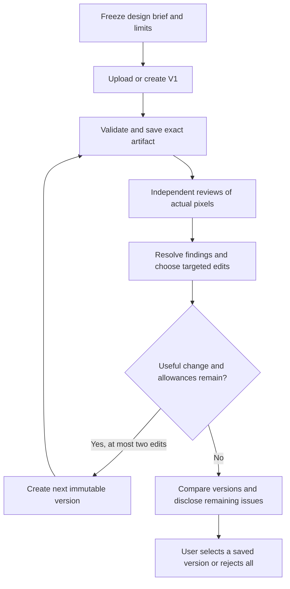

# Round Robin Visual Design and Image Review

Version 3 • November 15, 2026 • Demand-gated visual implementation contracts

Round Robin can extend independent review to actual images and rendered designs. A generator creates or edits an artifact, vision-capable advisers inspect the resulting pixels against the brief, and a bounded revision loop checks whether changes helped without breaking existing requirements. The user can select any saved version or reject all candidates.

This is planned functionality. The core text release remains phases 0–6. The [product audit](PRODUCT_AUDIT.md) and [delivery backlog](DELIVERY_BACKLOG.md) prioritize a useful text comparison before this expansion. [Phases 7–8](IMPLEMENTATION_PHASES.md) implement raster review and measured image improvement only after the demand gate below. Phase 7 depends on Phase 5's local release, not optional hosting. Phase 9 separately gates native interfaces and diagrams; it is not required to release justified raster functionality. Any public visual deployment must also satisfy Phase 6 and visual-specific access/recovery tests. The [failure contracts](FAILURE_HANDLING.md) apply throughout.

**Current status (November 16):** the user authorized construction through the gated visual and native extensions before resolving external blockers. Canonical private raster storage, immutable versions, receipt/review rules, bounded jobs, provider/worker integration and native rendering are tracked in the [implementation record](evidence/implementation-phases.md). Features remain disabled by default. Synthetic tests do not establish unmet visual demand, real critic performance, funded generation, useful improvement or release acceptance.

The [implementation blueprint](IMPLEMENTATION_BLUEPRINT.md) defines the common preflight/Start, command retention, input scope, exposure accounting, context and operator contracts. Visual mode extends those contracts explicitly; it cannot bypass them because generation is a different modality. Numeric raster limits in this document remain the visual-specific policy.

## Demand and release decisions

Before investing in Phase 7, document concrete unmet visual jobs from at least three target users in one supported raster domain, their attempted text workaround and why it failed. Core reliability and essential evidence import outrank visual expansion. Select one initial domain with competent human reviewers rather than promising artwork, websites, diagrams and farm designs together. This threshold is a prospective demand gate, not achieved research.

Review only can release after Phase 7's actual-input, provenance, critique and user-comprehension gates. Improve within limits additionally requires Phase 8's matched comparative human evaluation before release. If multi-critic editing shows no repeatable useful benefit over simpler alternatives, retain review-only or defer improvement. Do not infer image improvement from successful generation or agreement. The evaluation decision and any enabled limitations accompany the release.

## What each design type requires

| Use case | Appropriate output | Review and verification |
| --- | --- | --- |
| Illustration, product image, advertisement or concept art | Raster image with immutable source/reference and edit history | Actual-image critique, required-content checks, composition, visual consistency, intended-size legibility and preservation of locked elements. |
| Website or application interface | Native components/styles plus rendered screens at declared viewports | Review actual screenshots and also test navigation, interaction, responsive behavior and accessibility. A polished mockup is not evidence of working software. |
| Diagram, chart or editable graphic | Structured data and native SVG or another appropriate editable source, plus a render | Inspect the render and validate labels, numbers and relationships against source structure. Check editability and format requirements independently of appearance. |
| Farm, building or product concept | Conceptual image/layout and a decision brief with assumptions | Review visible layout and communication; retain site, engineering and local-validation dependencies. A persuasive image cannot certify structural adequacy, scale, compliance or construction readiness. |

Use image generation for raster artwork and image edits. Preserve or edit native code/vector assets when the requested deliverable needs those properties. Native renderers in Phase 9 run in isolated, resource-limited environments; the text MVP's tool permissions do not automatically authorize generated-code execution, deployment or changes to an external project.

## Capabilities and provider selection

Record and test capabilities for the selected model and endpoint: `can_review_images`, `can_generate_images`, `can_edit_images`, `supports_job_lookup`, `supports_idempotent_submit`, supported formats, input limits, output limits and conservative pricing rules. A provider brand alone does not establish any capability. Check a dated configuration during preflight and store its version with the run.

One configured image backend may generate while other providers review. For a complete generated-image review, require two distinct configured vision-capable critic providers different from the actual generator provider. The generator can offer additional self-critique, but it does not satisfy that independent quorum. In Review only mode require two distinct critics; when an uploaded image's generator provenance is unknown, disclose it rather than claiming independence from an unknown generator.

Image-input and generation/edit capabilities are documented separately by providers. Integration must verify the actual selected endpoints rather than assume every adviser can perform every operation. [OpenAI image inputs](https://developers.openai.com/api/docs/guides/images-vision), [OpenAI generation and editing](https://developers.openai.com/api/docs/guides/image-generation), [Claude image analysis](https://platform.claude.com/docs/en/build-with-claude/vision), [Gemini image understanding](https://ai.google.dev/gemini-api/docs/image-understanding).

## End to end workflow

### Freeze the design brief

Let the user choose Review only or Improve within limits before paid work begins. Capture purpose, audience, output format, dimensions/viewport, exact required text, references, constraints and elements that must stay unchanged. Label each attachment as an edit target, style reference or supporting input. Record which providers receive those inputs.

Extend the saved preflight with mode, artifact hashes, actual allowed generator/critic recipient set, endpoint capabilities, candidate/submission limits, conservative prices, required review/finish reserves and the visual active deadline. Use the common ten-minute pre-Start validity and 30-minute initial-admission expiry; an admitted image job retains its original visual deadline. All selected inputs share the declared recipient set, including derived critique/edit prompts. If a generator fallback is outside that set, it requires an explicitly reauthorized linked run; a switch within the recorded set preserves actual identity and every existing counter. Never silently increase recipients or introduce generation into Review only.

Separate hard requirements from preferences. Examples are “preserve the supplied logo and exact headline” versus “prefer a calmer color palette.” A clarification that changes a frozen requirement creates an explicit new brief/run; reviewers must not quietly alter the objective to make an image pass.

### Save the original artifact

Call the original uploaded or generated candidate V1 and subsequent intentional edits V2 and V3. Store immutable bytes, canonical hash, dimensions, format, parent, brief version, actual creator model/provider, settings and attempt/job references. A reference image is not automatically a candidate version. Do not overwrite V1 when an edit finishes.

Initially accept static PNG/JPEG through a separate visual input path: at most ten MiB per input, sixteen million decoded pixels and four reference images. Check declared and decoded type, dimensions, parser limits, ownership and selected-input scope before sharing. Apply orientation, reencode canonical pixels and strip EXIF/location metadata. Discard temporary raw input after normalization under the retention policy. Reject animation, SVG/HTML and unsupported formats from this raster path. Native-format handling has a separate Phase 9 gate.

Provider-generated images undergo the same validation before becoming ready or reaching critics. Originals, canonical images, crops, thumbnails and exports remain private and follow meeting deletion. Existing one-MiB text/Markdown upload rules continue to apply to text attachments.

### Review the actual pixels independently

Every critic receives the same fixed candidate and frozen brief. If a comparison claims improvement, it includes the relevant previous candidate too. Store a server-created input receipt with artifact/version, canonical hash, delivered-view hash/dimensions and any crop/resize transform. A model echoing a hash is not proof it received or correctly understood the image.

Use a shared overview and, when needed, up to three shared detail views per candidate. Record provider-specific preprocessing that is known; do not claim knowledge of undocumented internal resizing. Missing or rejected image input makes a review ineligible. A text-only adviser can discuss requirements but cannot count as inspecting the image.

Keep current-round critiques hidden from peers until their reviews settle. Ask for all blocking violations and the few most consequential improvements. Each finding contains:

- Server-bound artifact/view identity and actual reviewer provider/model.
- Criterion or requirement ID, severity and concise observation.
- Evidence category: visible feature, deterministic check, inference, preference or unverified concern.
- Global scope, native element ID, or approximate normalized region `[xmin, ymin, xmax, ymax]` in delivered-view coordinates, with mapping to the original.
- Proposed correction, preservation requirements and uncertainty.
- For revisions, the previous issue ID and whether it is resolved, unchanged, regressed or uncertain.

Coordinates help locate a concern; they are not precise measurements. Invalid geometry or stale-version bindings are rejected. Image content, extracted text and peer feedback remain untrusted data and cannot change tools, recipients, permissions or limits.

### Resolve findings and plan a revision

Advisers can challenge one another's specific observations and accept, reject, qualify or retain disagreement. The controller creates a small edit bundle tied to issue IDs: what to change, why, and what to preserve. Include justified no-change decisions. “No material issue” is valid; a reviewer need not invent objections.

Use criterion results such as pass, concern, fail, not checked and not applicable, with reasons. Subjective judgments remain labeled assessments. A majority vote or high average score cannot override a failed hard requirement. OCR may assist text inspection but cannot by itself establish correct spelling or legibility; important literal text is checked against the visible result and requested copy.

If critics disagree over taste, preserve the alternatives or ask the user for a preference when decisive. If the next edit cannot be stated concretely, stop with the unresolved finding instead of generating another arbitrary variation.

### Edit and check for regressions

An edit references the exact parent artifact and locked brief. Prefer targeted changes and explicitly preserve accepted elements. Save the new version, then repeat independent review of its actual pixels. Prior findings start pending recheck; editing the prompt or producing a new image never automatically resolves them.

Check both intended fixes and regressions: required text, brand elements, subject identity, composition constraints and output format can break while another aspect improves. Retain previous candidates and their review histories. The latest version is not automatically selected.

### Compare and choose

Provide synchronized before/after previews at comparable scale and crop, with zoom and version-specific annotations. Summarize changes, preserved requirements, resolved issues, new regressions and remaining uncertainty. Show actual review coverage separately from the recommended version and user-selected version.

Provide a keyboard-operable linear version list and text equivalents for every material annotation, including requirement, observation, location and disposition. Before/after sliders cannot be the only way to compare. Label version selection, zoom and review status accessibly, return focus predictably after dialogs, and keep findings understandable without color. Verify these journeys against the core WCAG 2.2 AA target with manual keyboard, screen-reader and reflow checks.

Return the selected asset and, where supported, its editable source plus a report linking versions, critique, edit bundles, checks, cost and stopping reason. The user can keep V1, choose V2/V3, decline all, or start a new brief. Selection does not deploy, publish or send the design anywhere.

## Iteration spending and time limits

The visual preset is selected and shown before work begins; a text meeting never silently escalates into generation. These are initial ceilings to validate, not promises that every run produces three candidates.

| Control | Visual-mode decision |
| --- | --- |
| Candidate versions | At most three: V1 plus two intentional edits. Retry does not create a fresh version or allowance. |
| Image generation/edit submissions | At most four dispatched attempts total, including rejected, failed, ambiguous and retried submissions whether charged or not. Request one candidate per submission. |
| Logical step allowance | At most two actual inference calls per stable step across retry/repair/fallback/manual retry; actual creator changes do not reset identity. |
| Shared inference ceiling | At most 24 actual upstream inference attempts across text, vision, generation and edits combined, including rejected/unknown attempts, retries and model-tool follow-ups regardless of billing. |
| Spending | One displayed monetary limit covers all modalities, image-input charges, tool/status charges where applicable, and exports if priced. Reserve conservative maximum exposure and next-review/final-audit headroom before another image operation. |
| Aggregate exposure | Owner and deployment daily/monthly policies and the operator kill switch apply to all visual work, sequential runs and follow-ups. A visual-mode budget never renews aggregate allowance or releases unknown charges. |
| Finish resources | Protect required next-review/final-audit inference slots and bounded critical-path time as well as money. A new image cannot consume the resources needed to assess it. |
| Active time | At most 1,800 admitted seconds for the declared visual preset. Core text mode remains 600 seconds. Remote job waits/polling consume visual active time; there is no indefinite pause. |
| Image capacity | One active image-generation job application-wide, within the normal personal admission policy. Preserve uncertainty for unknown remote work after slot expiry. |
| Status transport | At most 60 documented read-only status polls per run, with bounded backoff; downloads/status retries never create a new image job. Any operation starting new inference consumes the shared inference ceiling. |

Stop early when requirements are satisfied, no useful improvement appears, regressions recur, necessary review/input is unavailable, the user cancels, or any allowance is exhausted. Return saved candidates with their real review status. Do not use a fresh candidate ID, provider switch or “repair” label to evade limits. Unknown generation prices or usage require conservative bounds; missing usage never becomes zero.

Reserve a required review/finish pool once, then convert designated funds into actual attempt reservations under the common ledger transaction. Never double count a hold and its converted inference, or clear an unknown image charge through a conservative booking/period rollover. Scope temporary signed download URLs to the saved provider job and private adapter destination policy; public evidence URL rules must not expose job tokens in citations or logs. Before enabling image storage, explicitly configure a visual storage/export profile rather than assuming the core 100-MiB owner quota can hold every candidate indefinitely.

## Long image jobs and recovery

The application exposes a durable background job, but upstream providers have different semantics. An application queue does not turn a synchronous API into a recoverable provider job.

When an endpoint supports retrievable asynchronous jobs, persist creation authorization first and provider job identity immediately after acknowledgment. Submit, status and download are separate bounded tasks. Resume polling only that saved job after restart, within the original active deadline. If creation acknowledgment is lost, use documented idempotency/lookup where actually supported; otherwise retain an unknown outcome and do not blindly submit another generation.

For synchronous endpoints, use a separate image-worker queue and isolated Celery broker namespace/database: at most 600 seconds for one generation call, a 630-second soft limit, 660-second hard limit, 720-second lease, ten-second heartbeat and 900-second broker visibility timeout. All consumers sharing that broker namespace must use consistent visibility settings; splitting queues alone does not isolate transport settings. Bound the call by remaining run time and remaining soft-task time minus twenty seconds for persistence and five seconds for cleanup. Ordinary text workers retain their shorter limits in their own namespace. Verify the actual adapter/worker behavior before enabling this path.

After a timeout/crash without recoverable job identity, content may be unrecoverable while charges remain possible. Default to a visible unknown outcome. Image retries occur only under the bounded controller policy while the original run remains eligible and nonterminal, with a spare logical call, submission slot and reservation; ambiguous submission is not blindly repeated. Terminal continuation requires an explicit linked run with new limits. The core terminal manual-retry action still covers synthesis/audit only. A delayed response is fenced from changing terminal/selected results. Cancellation tries to abort remote work best effort; deletion also removes late assets. Restored jobs pass execution-epoch and deletion/accounting gates before any submission.

Expired artifact URLs or failed downloads are repaired against the same completed job when supported, without regeneration. A provider refusal remains a refusal and cannot trigger another provider to evade it. A failed critic does not become a successful review merely because generation succeeded.

## Planned code and data

Paths below are relative to `backend/src/round_robin/` and remain implementation targets.

| Module | Responsibility |
| --- | --- |
| `visual/service.py` | Coordinate capability preflight, receipt validation, version evaluation and bounded edit planning through the visual modules. |
| `visual/assets.py` | Validate/reencode input, store immutable artifact versions, derive views and record coordinate transforms. |
| `visual/reviews.py` | Build image-bearing packets, bind input receipts, validate localized findings and count actual independent critics. |
| `visual/iterations.py` | Resolve issues, preserve locked requirements, plan edits, check regressions and record human selection. |
| `visual/jobs.py` | Submit/reconcile generation, poll/download known jobs, enforce image-operation limits and fence late results. |
| `providers/images.py` | Capability-specific image generation/edit adapters, pricing bounds, genuine job/idempotency support and normalized outcomes. |
| `worker/image_tasks.py` | Separately bounded synchronous image tasks or short async submit/status/download tasks. |
| `visual/renderers/` | Later native-source renderers in isolated sandboxes with no secrets, account cookies, host filesystem access or uncontrolled network. |

Extend the run contract with output mode, visual policy, render budget and candidate limits. Store `DesignVersion`, `VisualInputReceipt`, `VisualFinding`, `EditBundle`, `ImageOperation`, `RenderSnapshot` and `DesignSelection` records. A native snapshot binds source revision, viewport, fonts/assets, renderer version and screenshot hash; deterministic source checks remain separate from image assessments.

Use stable logical keys that include candidate identity and immutable role slot. Execution retry retains its candidate/key/counters; an intentional edit gets the next bounded candidate. Fallback records actual provider on the attempt. Apply the existing recovery-generation rules to eligible execution recovery without invalidating immutable successful artifacts.

Implement the following owner-scoped routes with generated contracts before enabling their corresponding phase:

| Route | Purpose |
| --- | --- |
| `POST /api/meetings/:id/visual-inputs` | Validate and save selected private raster targets/references under visual upload limits. |
| `POST /api/meetings/:id/design-runs` | Create a Review only or Improve run with frozen brief, recipients, capability policy and declared limits. |
| `GET /api/runs/:id/designs` | Read immutable candidates, actual review status and authorized artifact/view references. |
| `GET /api/runs/:id/visual-reviews?version=...` | Read findings, view transforms, dispositions and actual critic coverage for one version. |
| `POST /api/runs/:id/design-edits` | Request the next bounded candidate with expected run/brief and parent version plus targeted issues. |
| `POST /api/runs/:id/design-selection` | Record the user's choice of an existing candidate, or decline all, without generating or publishing anything. |

Commands are idempotent and check expected versions and ownership. New image work rejects terminal, cancelled or deleted runs; continuing it requires an explicit linked run with new limits. Selection is metadata and can choose an existing candidate after completion/cancellation without reviving generation. Deleted meetings reject selection and all asset reads. Existing download, export and command-outcome routes retain their authorization rules. The UI cannot invoke a generator or renderer outside the controller.

## Tests and release evidence

The failure register contains 88 core and 12 visual requirements, for 100 planned individual scenarios. Phase allocation and implementation evidence belong in the [phase plan](IMPLEMENTATION_PHASES.md); scenario assertions are in [failure handling](FAILURE_HANDLING.md). These counts describe requirements, not passing tests. Required tests include:

- Wrong/missing image payload and fluent text-only critique cannot satisfy visual coverage; hash echo cannot override a server receipt.
- Swapped/stale versions and crop/resize transforms cannot attach findings to the wrong pixels.
- Corrupt/oversized images, metadata leakage and foreign assets are blocked before provider dispatch; OCR/image injection cannot alter permissions or spending.
- Generated text that is visibly wrong cannot pass solely because mocked OCR returns the requested text.
- Generator self-endorsement plus one outside critic cannot claim two independent critics.
- Editing one issue while breaking a locked requirement preserves the regression and earlier selectable version.
- Lost submission acknowledgment, worker restart, failed polling/download and expired URLs do not create hidden duplicate generations or refunds.
- Limits hold across unknown attempts, new candidate labels, manual retries, cancellation, deletion and backup restoration.
- Native renderers cannot access secrets, arbitrary local files or uncontrolled network; UI/diagram tests check behavior/source relationships separately from screenshot appearance.

Also combine slow generation with cancellation, wrong-version review with an intervening edit, expired download with exhausted submission allowance, and deletion with late job completion/restore. Deterministic fixtures establish control behavior; human-reviewed images assess whether critics actually found defects and edits improved the requested design.

Before releasing automatic improvement, compare generation alone, one-critic revision and multi-critic revision on matched briefs, initial candidates and comparable image-operation budgets. Blind human review checks brief satisfaction, actual resolved defects, regressions and useful preference differences alongside latency and cost. Use domains that can be judged competently and report their limits. Do not claim that more reviewers guarantee a better image or that passing appearance checks certifies every design use case.

This is a Phase 8 release gate, not work deferred to native rendering in Phase 9. Freeze a minimum of 12 representative briefs and their locked requirements, use matched initial candidates, repeat four fixed briefs three times per workflow, and have two independent competent reviewers score at least half the set and every suspected hard-requirement regression. Preserve failures, refusals, unknown exposure, neutral outcomes and rater disagreements. Predeclare acceptable cost/latency and adjudicate material disagreement without dropping unfavorable candidates. Release automatic improvement only when paired results show repeatable user-valued gains within those limits without concealing hard-requirement failures; otherwise retain the useful simpler mode and record the decision. Additional native output domains need their own fixtures, reviewers and functional gates.

Use exactly 12 initial briefs unless a larger manifest is frozen before spending. Four fixed briefs receive three total executions each, including their primary; the other eight run once. That is 20 trials/workflow and 60 across generation-only, one-critic and multi-critic arms. Primary comparisons use 12 matched cases, not 20 independent samples; repeats assess variability. Declare a separate batch inference/image-submission/polling/currency ceiling and apply aggregate policies before any live visual evaluation. User-selected candidate identity, actual review coverage and human quality judgments remain separate records.
